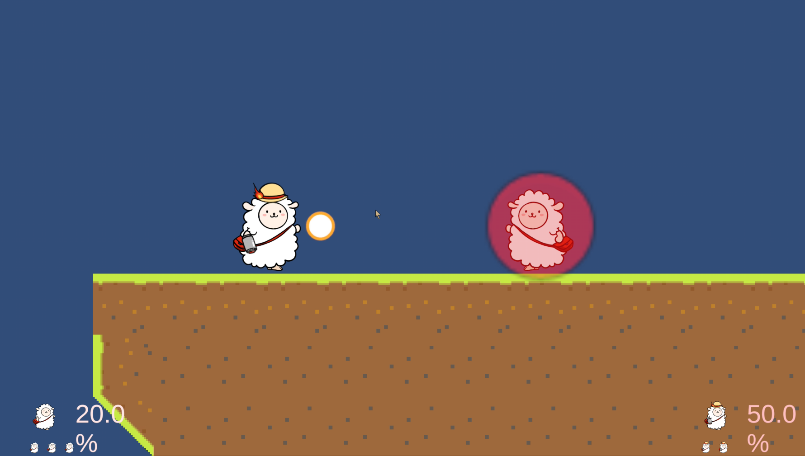

# Smash Prototype

大乱闘スマッシュブラザーズにインスパイアされた、オンライン対戦対応の 2D プラットフォームファイティングゲームです。
Unity 6 と Photon Fusion 2 を用いて、ローカル対戦とネットワーク対戦の両方を一から実装しました。

<div align="left">
  
</div>


---

## 目次

- [概要](#概要)
- [開発情報](#開発情報)
- [プレイ方法](#プレイ方法)
- [使用技術](#使用技術)
- [実装内容](#実装内容)
- [こだわり・工夫](#こだわり工夫)
- [ディレクトリ構成](#ディレクトリ構成)
- [使用アセット](#使用アセット)

---

## 概要

### どんなゲームか

| 項目 | 詳細 |
|------|------|
| ジャンル | 2D プラットフォームファイティング |
| プラットフォーム | PC（Windows） |
| プレイ人数 | 1 vs 1（ローカル対戦 / オンライン対戦） |

ダメージを蓄積させて相手を画面外（ブラストゾーン）へ吹き飛ばし、残機 3 を先に削り切った方が勝利です。

1. タイトル画面からモードを選択（トレーニング / オンライン）
2. オンラインの場合はキャラクターを選び、ルーム名を入力して待機室へ
3. 両者が READY になると対戦開始
4. 攻撃でダメージを蓄積させ、吹き飛ばして撃墜を狙う
5. どちらかのストックが 0 になるとリザルト画面へ

```
タイトル画面
    └→ モード選択
         ├→ [トレーニング] → 対戦（ローカル 2P） → リザルト
         └→ [オンライン]  → キャラ選択 → 待機室（READY 同期）
                                └→ 対戦（Photon Fusion 同期） → リザルト
```

### 制作の目的

> 対戦ゲームの根幹である「吹き飛び・ガード・撃墜」のゲームロジックと、
> それをオンラインで破綻なく同期させるネットワーク設計を、自分の手で一通り実装することを目指して制作しました。

---

## 開発情報

| 項目 | 詳細 |
|------|------|
| 開発期間 | 2026 年 4 月〜5 月 |
| 開発人数 | 1 人 |
| 担当 | 企画・プログラム・ネットワーク実装・UI（全般） |

---

## プレイ方法

### 公開リンク / ダウンロード

ビルド済みファイルは [Releases ページ](https://github.com/nasu-cell/Smash-Prototype/releases) からダウンロードできます。

1. 最新リリースから **Smash-Prototype.zip** をダウンロードして展開
2. 展開したフォルダ内の **.exe ファイル** をダブルクリックして起動

### プレイ動画

**ローカル対戦**

[](https://www.youtube.com/watch?v=DW82-Re9IUk)

**通信対戦**

[](https://www.youtube.com/watch?v=CZtP2-W2iOo)

### 動作環境

- Unity 6000.3.11f1 以降
- Photon Fusion 2 SDK（Photon の App ID が必要）
- オンライン対戦時はインターネット接続

### Unity エディタで起動する手順

```bash
# 1. リポジトリのクローン
git clone https://github.com/nasu-cell/Smash-Prototype.git

# 2. Unity Hub でプロジェクトを開く
#    [Open] → クローンしたフォルダを選択

# 3. Photon App ID を設定
#    Photon Dashboard (https://dashboard.photonengine.com/) で App ID を取得し、
#    Assets/Photon/Fusion/Resources/NetworkProjectConfig に設定

# 4. 最初のシーンを開く
#    Assets/Scenes/TitleScene.unity

# 5. Play ボタンでゲーム開始
```

> オンライン対戦をエディタ上で 1 台で検証する場合は、ParrelSync でクローンプロジェクトを作成し、2 つのエディタで同じルーム名を入力してください。

### 操作方法

**トレーニング（ローカル 2P）**

| 操作 | P1 | P2 |
|------|----|----|
| 左右移動 | `A` / `D` | `←` / `→` |
| ジャンプ（2 段ジャンプ対応） | `Space` | `Right Shift` |
| 攻撃（方向キー併用で横・上攻撃） | `F` | `L` |
| 必殺技（↑ 併用で復帰技） | `G` | `K` |
| ガード | `Left Shift` | `テンキー 0` |

**オンライン対戦**

| 操作 | キー |
|------|------|
| 左右移動 | `A` / `D` |
| 上入力 | `W` |
| ジャンプ（2 段ジャンプ対応） | `Space` |
| 攻撃（方向キー併用で横・上攻撃） | `Backspace` |
| 必殺技（`W` 併用で復帰技） | `Right Shift` |
| ガード | `P` |

---

## 使用技術

| カテゴリ | 技術 |
|----------|------|
| **ゲームエンジン** | Unity 6000.3.11f1 |
| **言語** | C# |
| **ネットワーク** | Photon Fusion 2（Shared Mode） |
| **グラフィクス** | Universal Render Pipeline（URP 2D） |
| **UI** | uGUI / TextMesh Pro |
| **アニメーション補助** | DOTween |
| **入力** | Input Manager（`Input.GetKey` / KeyCode を Inspector で割り当て） |
| **マルチプレイ検証** | ParrelSync |
| **バージョン管理** | Git / GitHub |
| **開発環境** | Windows 11 / Visual Studio |

---

## 実装内容

### 全体構成

```
NetworkLauncher           Photon Fusion のセッション管理・キャラ Spawn・切断通知
  │
  ├─ WaitingRoomManager   待機室で PlayerLobbyInfo の READY 状態を監視
  │
  └─ OnlineGameManager    オンライン対戦のゲームループ・勝敗判定
       │
       ├─ NetworkPlayerRegistrar  Spawn 時に P1/P2 登録・Rigidbody 設定
       ├─ DynamicCamera           2 人を追従するズームカメラ
       └─ UIManager               ダメージ%・ストック表示

Fighter（キャラ Prefab）
  ├─ ActorController      入力受付・移動・ジャンプ・攻撃の出し分け
  ├─ FighterCombat        攻撃の実行・ヒットボックス生成・RPC 同期
  ├─ PlayerStatus         ダメージ・ストック・シールド・スタン状態
  │    └─ KnockbackCalculator  吹き飛び量の計算
  └─ HitArea              ヒットボックスの当たり判定

GameManager               トレーニング（ローカル 2P）のゲームループ
GameDataContainer         シーンを跨ぐデータ保持（DontDestroyOnLoad）
```

### 1. ダメージ蓄積とノックバック

蓄積ダメージが大きいほど吹き飛びが強くなる、スマブラ方式の計算を実装しました。
被弾時に速度をリセットしてから `ForceMode2D.Impulse` で力を加え、0.5 秒間のスタンを発生させます。

```csharp
public float Calculate(float currentDamage, float baseKnockback)
{
    // 100% 溜まっていると、基礎値の 11 倍の力で飛ぶ
    float multiplier = (currentDamage * 0.1f) + 1.0f;
    return baseKnockback * multiplier;
}
```

### 2. 当たり判定とガード

`HitArea` が衝突相手のレイヤーを見て「シールド命中」と「本体命中」を判別します。
ノックバック方向は右向き基準のベクトルを持たせ、攻撃者の向きに応じて X 成分を反転させています。

```csharp
// シールド命中 → シールドを削る
if (collision.gameObject.layer == LayerMask.NameToLayer("Shield"))
{
    shieldedPlayer.TakeShieldDamage(damageValue, guardDamageMultiplier);
    return;
}

// 本体命中 → 向きを反映した方向に吹き飛ばす
Vector2 finalDirection = new Vector2(knockbackAngle.x * facingDir, knockbackAngle.y);
targetStatus.TakeDamage(damageValue, baseKnockback, finalDirection);
```

シールドはガード中に縮小・非ガード中に回復し、最小サイズに達するとシールドブレイク（3 秒間行動不能）になります。

### 3. 動的ズームカメラ

2 プレイヤーの中間点を `SmoothDamp` で追従し、距離に応じて Orthographic Size を補間します。
ステージ端では移動範囲を制限し、ブラストゾーンの外側が映りすぎないようにしています。

```csharp
float distance = Vector2.Distance(player1.position, player2.position);
float newSize = Mathf.Lerp(minSize, maxSize, distance / zoomLimiter);
cam.orthographicSize = Mathf.Lerp(cam.orthographicSize, newSize, Time.deltaTime * 5f);
```

### 4. オンライン対戦（Photon Fusion 2）

- Shared Mode でルーム名を指定してセッションを作成・参加
- 待機室では `PlayerLobbyInfo` の `[Networked]` プロパティでキャラ選択と READY 状態を同期
- ダメージ・ストック・シールド状態は `[Networked]` プロパティ、攻撃演出は RPC で同期
- 対戦中に相手が切断した場合は、残った側の不戦勝としてリザルトへ遷移

---

## こだわり・工夫

### オフライン・オンラインで同じスクリプトを共有

- **課題:** トレーニング（ローカル）とオンラインで同じキャラ挙動を使いたいが、オンラインでは `[Networked]` プロパティと RPC が必要で、そのままではローカルで動かない。
- **解決:** `Spawned()` が呼ばれたかどうかで `useNetworked` を切り替え、公開プロパティの getter/setter 内でローカルフィールドと Networked プロパティを振り分けた。タイマーもオンラインは `TickTimer`、オフラインは `Invoke` に切り替えている。
- **設計意図:** 呼び出し側（`HitArea` や `ActorController`）がモードを意識せずに済むようにし、ロジックの二重管理を避けるため。

```csharp
public float totalDamage
{
    get => IsNetActive ? NetTotalDamage : _localTotalDamage;
    set { _localTotalDamage = value; if (IsNetActive && HasStateAuthority) NetTotalDamage = value; }
}

public void TakeDamage(float baseDamage, float baseKnockback, Vector2 direction)
{
    if (useNetworked) RPC_TakeDamage(baseDamage, baseKnockback, direction);
    else ApplyDamage(baseDamage, baseKnockback, direction);
}
```

### ネットワーク権限の分離

- **課題:** Shared Mode では各プレイヤーが自分のキャラの StateAuthority を持つため、両クライアントで当たり判定を処理するとダメージが二重に適用される。
- **解決:** 当たり判定は「攻撃した側の StateAuthority」だけが処理し、ダメージの適用は `RpcTargets.StateAuthority` の RPC で「被弾した側」に任せた。
- **設計意図:** 状態を書き換えるのは常にそのオブジェクトの所有者だけ、というルールに揃えることで、同期の整合性を保つため。

### Rigidbody2D の使い分け

- **課題:** リモートのキャラにも物理演算が働くと、NetworkTransform による位置同期と衝突して挙動がガタつく。
- **解決:** Spawn 時に、自分が操作するキャラは `Dynamic`、相手のキャラは `Kinematic` に切り替えた。
- **設計意図:** 物理シミュレーションは所有者側だけで行い、相手側は同期された位置を表示するだけにするため。

```csharp
rb.bodyType = isMine ? RigidbodyType2D.Dynamic : RigidbodyType2D.Kinematic;
```

### 今後の課題

- [ ] Input System への移行とキーコンフィグ機能
- [ ] キャラクターごとの技・性能の差別化
- [ ] 攻撃のヒットストップ・エフェクト・サウンドの追加
- [ ] 通信遅延を考慮したラグ補償

---

## ディレクトリ構成

```
Assets/
├── Materials/        # 2D 物理マテリアル（摩擦なし / 高摩擦）
├── Prefabs/          # キャラクター・必殺技・ロビー情報の Prefab
├── Scenes/           # タイトル〜リザルトまでの各シーン
├── Settings/         # URP / 2D Renderer 設定
└── Scripts/
    ├── Player/
    │   ├── ActorController.cs        # 入力受付・移動・ジャンプ・攻撃の出し分け
    │   ├── PlayerStatus.cs           # ダメージ / ストック / シールド / スタン状態管理
    │   ├── HitArea.cs                # ヒットボックスの衝突処理・攻撃権限チェック
    │   └── KnockbackCalculator.cs    # ノックバック計算式
    ├── Button/
    │   ├── FighterCombat.cs          # 攻撃実行・アニメーション・ネットワーク同期
    │   └── GuardShield.cs            # シールドのスケール・見た目制御
    ├── Manager/
    │   ├── GameManager.cs            # ローカル対戦のゲームループ
    │   ├── OnlineGameManager.cs      # オンライン対戦のゲームループ・勝敗判定
    │   ├── UIManager.cs              # HUD 更新（ダメージ / ストック）
    │   ├── WaitingRoomManager.cs     # 待機室の READY 同期
    │   ├── CharacterSelectManager.cs # キャラクター選択
    │   ├── ResultManager.cs          # リザルト表示
    │   ├── SceneController.cs        # シーン遷移ユーティリティ
    │   └── GameDataContainer.cs      # シーン跨ぎデータ保持
    ├── Network/
    │   ├── NetworkLauncher.cs        # Photon Fusion のセッション管理
    │   ├── NetworkPlayerResistrar.cs # プレイヤー生成時の登録処理
    │   ├── NetworkSpriteFlipSync.cs  # スプライト向き同期
    │   └── PlayerLobbyInfo.cs        # 待機室でのキャラ選択 / READY 状態同期
    └── DynamicCamera.cs              # 動的ズームカメラ
```

外部アセットは [使用アセット](#使用アセット) を参照してください。

---

## 使用アセット

| 素材名 | 提供元 | 用途 | ライセンス |
|--------|--------|------|------------|
| Photon Fusion 2 | Exit Games | オンライン対戦の通信・同期 | Photon SDK License |
| DOTween | Demigiant | UI アニメーション | DOTween License（無料版） |
| ParrelSync | VeriorPies | 1 台でのマルチプレイ動作検証 | MIT License |
| TextMesh Pro（LiberationSans） | Unity Technologies | UI テキスト表示 | Unity Companion License / SIL OFL 1.1 |

本プロジェクトに含まれるサードパーティアセットは、各提供元のライセンスに従います。

---

## 作者

- **GitHub** : [github.com/nasu-cell](https://github.com/nasu-cell)
- **メール** : shii101218@gmail.com
